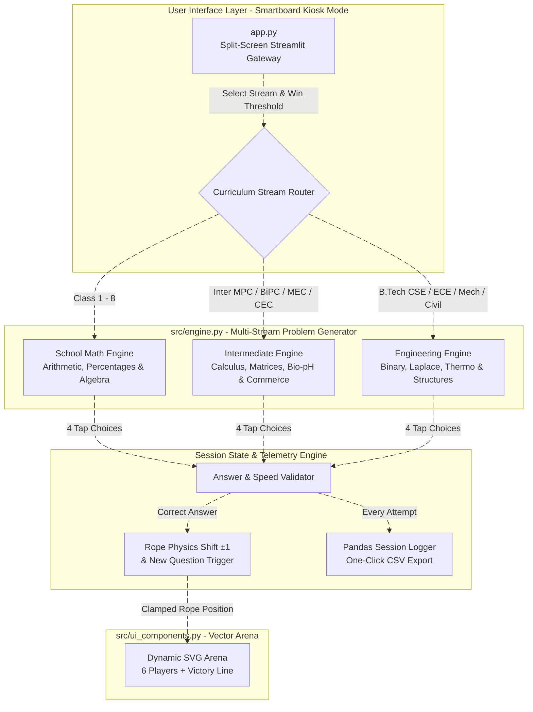

# 🪢 Tug-of-War Maths & Engineering Arena

An enterprise-grade, smartboard-ready classroom and laboratory competition platform built with **Python** and **Streamlit**. Two teams compete simultaneously to pull a virtual tug-of-war rope across the victory line by solving curriculum-aligned problems across **School (Class 1–8)**, **Intermediate (MPC, BiPC, MEC, CEC)**, and **B.Tech Engineering (CSE/IT, ECE/EEE, Mechanical, Civil)** streams.

## About

Tug-of-War Maths & Engineering Arena transforms passive problem-solving into an active, collaborative team challenge designed for interactive classroom smartboards and digital displays.

Built and maintained by [@SRINIVASTA](https://github.com/SRINIVASTA), this repository features a decoupled multi-stream problem engine, a real-time dynamic SVG vector arena with 3 illustrated players per team, a distraction-free dark-mode smartboard interface, and automated CI/CD unit testing via GitHub Actions.

## Modules in this repo

| Module | Description |
| :--- | :--- |
| `src/engine.py` | Decoupled problem generator and validator supporting 10 distinct academic streams across School, Intermediate, and B.Tech branches with randomized multiple-choice distractors. |
| `src/ui_components.py` | Dark-mode smartboard CSS injector, custom SVG vector tug-of-war arena (3 players per team with dynamic rope physics), and fixed bottom branding bar. |
| `app.py` | Main Streamlit web application handling split-screen team controls, session state tracking, response-time telemetry, and one-click CSV report exports. |
| `tests/test_engine.py` | Automated `pytest` suite executing 500+ randomized checks across all academic streams and SVG rendering helpers. |

### Architecture & Workflow



### Supported Academic Streams

* **School Levels (Class 1–8):** Addition & Subtraction (≤ 10), Multi-digit Operations, Multiplication/Division, Percentages, and Linear Equations.
* **Intermediate (Class 11–12):**
  * **MPC:** Determinants, Derivatives, and Trigonometry.
  * **BiPC:** pH/pOH Calculations, Cellular Respiration ATP, and Mendelian Genetics Ratios.
  * **MEC / CEC:** Simple Interest, Price Elasticity of Demand, Accountancy, and Statistics.
* **B.Tech Engineering Branches:**
  * **CSE / IT:** Binary Conversion, Modular Arithmetic, Algorithm Time Complexity (Big-O), and Networking.
  * **ECE / EEE:** Ohm's Law Networks, Dynamic Laplace Transforms, Nyquist Sampling, and Digital Gates.
  * **Mechanical:** Engineering Mechanics, Fluid Dynamics (Bernoulli/Reynolds), Thermodynamics, and Machine Design.
  * **Civil:** Cantilever Bending Moments, Compressive Stress, Concrete Mix Ratios, Surveying, and Geotech.

### Key Capabilities

* **Zero-Scroll Smartboard Kiosk UI:** Pure dark-mode theme with oversized touch-friendly answer buttons, hidden Streamlit chrome, and a fixed bottom branding bar.
* **Dynamic Vector Tug-of-War Arena:** Custom SVG canvas featuring 3 leaning players per side and a central victory flag that shifts smoothly with every correct answer.
* **Teacher & Faculty Analytics:** Tracks per-team accuracy and response times in seconds, exportable as a `.CSV` report at the end of any session.

## Repository Structure

```text
tug-of-war-maths/
├── .github/
│   └── workflows/
│       └── ci.yml              # Automated pytest quality gate on push/PR
├── .streamlit/
│   └── config.toml             # Dark theme & minimal toolbar configuration
├── src/
│   ├── __init__.py
│   ├── engine.py               # Multi-stream problem & choice generator
│   └── ui_components.py        # Custom SVG arena, kiosk CSS & fixed footer
├── tests/
│   └── test_engine.py          # Parametrized unit tests across all 10 streams
├── .gitignore
├── app.py                      # Main split-screen web application
├── Dockerfile                  # Container setup for self-hosted lab servers
├── README.md
└── requirements.txt            # Production Python dependencies
```

## Installation & Local Setup

### 1. Clone the repository

```bash
git clone https://github.com
cd tug-of-war-maths
```

### 2. Set up Python environment

```bash
# Create virtual environment
python -m venv venv

# Activate on Windows
venv\Scripts\activate

# Activate on macOS / Linux
source venv/bin/activate

# Install dependencies
pip install -r requirements.txt
```

### 3. Run unit tests

```bash
python -m pytest
```

### 4. Launch the application

```bash
streamlit run app.py
```

Open your browser and navigate to `http://localhost:8501`.

## License

This repository is licensed under the MIT License — Copyright (c) 2026 [SRINIVASTA](https://github.com/SRINIVASTA).

## Disclaimer

This application is designed for educational engagement, classroom gamification, and academic practice across school and engineering curricula.

## ⭐ Support & Contribution

If you clone, test, or deploy this project in your classroom or lab, please consider giving it a **Star (⭐)** on GitHub!

* **Found a bug or want to add a new subject track?** Open an [Issue](https://github.com).
* **Want to contribute?** Fork this repository and submit a Pull Request.

---

* **Lead Architect & Developer:** [T A Srinivas (Srinivasta)](https://github.com/SRINIVASTA) • **Tanakala AI Solutions**

### 🌐 Let’s Connect

[](https://www.linkedin.com/in/srinivas-t-a-557637119/)
[](https://www.kaggle.com/srinivasta)
[](mailto:tasrinivass@gmail.com)
[](https://github.com/SRINIVASTA)
[](https://srinivasta.github.io)

💡 *“Bridging two decades of analytical expertise with modern AI and interactive engineering to build engaging, real-world learning systems.”*
